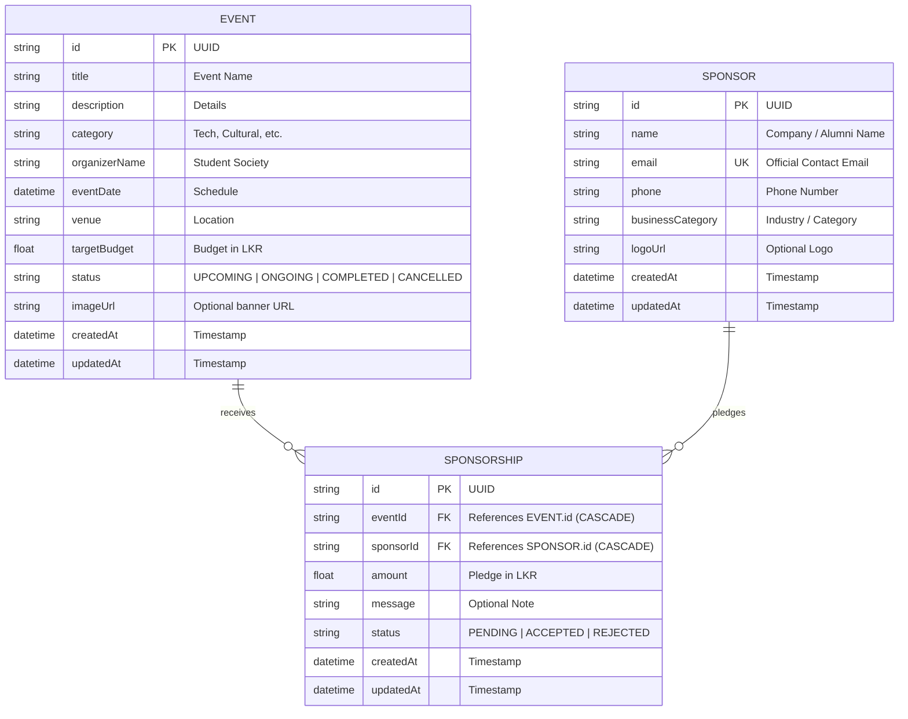

# CampusBridge — Campus Events & Micro-Sponsorship Platform

[](https://github.com)
[](https://github.com)
[](https://github.com)

**CampusBridge** is a modern full-stack web application developed for the university module **EC4307 Web Application Development**. It bridges university student organizations with alumni and local business sponsors through verified micro-sponsorship pledges, real-time funding progress tracking, and transparent campaign management.

---

## 📑 Table of Contents
1. [Project Overview & Problem Statement](#project-overview--problem-statement)
2. [Key Features](#key-features)
3. [Technology Stack](#technology-stack)
4. [System Architecture](#system-architecture)
5. [Database Design & ERD](#database-design--erd)
6. [Prerequisites & Installation](#prerequisites--installation)
7. [Running the Application](#running-the-application)
8. [API Endpoints Summary](#api-endpoints-summary)
9. [Automated Testing & Verification](#automated-testing--verification)
10. [Academic Evaluation Rubric Mapping](#academic-evaluation-rubric-mapping)
11. [Troubleshooting](#troubleshooting)

---

## 1. Project Overview & Problem Statement

### The Problem
University societies (e.g., Rotaract, IEEE Student Branches, Arts & Sports Councils) frequently organize impactful hackathons, cultural festivals, and community initiatives. However, securing financial support is often fragmented. On the other side, local businesses, startups, and alumni often wish to support campus initiatives with modest financial contributions (micro-sponsorships like LKR 10,000 to 50,000), but lack a direct, transparent discovery platform.

### The Solution: CampusBridge
CampusBridge delivers a centralized portal where:
- **Student Societies** can publish detailed event proposals, establish realistic target budgets in LKR, and manage campaign lifecycles.
- **Sponsors & Alumni** can discover ongoing student initiatives, review budget breakdowns, and submit recorded micro-sponsorship pledges.
- **Financial Transparency** is ensured by tracking confirmed pledges (`ACCEPTED`) versus pipeline pledges (`PENDING`), dynamically recalculating progress bars, and capping funding visualizations at 100%.

> **Note on Payment Scope:** For the academic scope of this mini-project, financial transactions are modeled as recorded pledges and confirmed agreements. No external payment gateway fees or pretend bank transactions are simulated.

---

## 2. Key Features

### 📊 Module A: Centralized Dashboard
- Real-time aggregated statistics from the SQLite database:
  - Total Campus Events & Upcoming Schedules
  - Registered Sponsors & Alumni Profiles
  - Total Accepted Micro-Sponsorship Funds (LKR)
  - Pending Review Pipeline Total (LKR)
- Live stream of recent sponsorship pledges.
- Interactive cards featuring top upcoming events with real-time funding progress bars.

### 📅 Module B: Event Management (Primary CRUD Entity)
- **CREATE:** Add new campus events with title, description, category, organizer, date/time, venue, target budget (LKR), status, and optional banner image URL.
- **READ:** Search events by title/venue/organizer, filter by category (*Technology, Cultural, Sports, Academic, Community*) and status (*UPCOMING, ONGOING, COMPLETED, CANCELLED*), and sort ascending/descending.
- **UPDATE:** In-place modal editing with form pre-population, input validation, and immediate UI refresh.
- **DELETE:** Safe event deletion with a confirmation dialog and documented cascading deletion of associated pledges.
- **DETAILS:** Dedicated event landing page displaying the complete campaign story, donor list, and pledge contribution widget.

### 🏢 Module C: Sponsor Directory
- Register and maintain business and alumni profiles with email, phone, business category (*Software & IT, Food & Beverage, Engineering & Tech, Banking & Finance, Alumni*), and logos.
- Real-time aggregation of total accepted financial contributions and count of supported campus events.
- Full editing and safe deletion safeguards.

### 🤝 Module D: Micro-Sponsorship Pledges & Workflow
- Record pledges linking a specific sponsor to a campus event with a custom message and pledge amount.
- Status workflow: Transition pledges between `PENDING`, `ACCEPTED`, and `REJECTED`.
- Accurate calculation rules:
  $$\text{Funded Amount} = \sum_{\text{status} = \text{'ACCEPTED'}} \text{Pledge Amount}$$
  *Pending and rejected amounts are never conflated with confirmed funding.*

### 📈 Module E: Analytics & Visualizations
- Interactive Recharts charts:
  - Event distribution by society category (Bar Chart).
  - Target Budget vs. Accepted Funding achieved per event (Comparison Bar Chart).
  - Distribution breakdown of Accepted, Pending, and Rejected pledge volumes.

---

## 3. Technology Stack

| Layer | Technologies Used |
|---|---|
| **Frontend** | React 18, TypeScript, Vite, Tailwind CSS, React Router v6, Lucide React, Recharts |
| **Backend** | Node.js (v24+), Express.js, TypeScript, tsx, Zod (Schema Validation), CORS, Dotenv |
| **Database** | SQLite, Prisma ORM (Client, Migrations, Seed) |
| **Testing** | Node.js Native Test Runner (`node:test`, `node:assert`) |
| **Version Control** | Git & GitHub |

---

## 4. System Architecture

```
+-----------------------------------------------------------------------+
|                    Client Tier (Frontend - React + Vite)              |
|   - Component Architecture (Navbar, Sidebar, Modals, ProgressBars)    |
|   - Type-safe API Client Service (/src/services/api.ts)               |
|   - Responsive Layout (Tailwind CSS - Mobile / Desktop)               |
+-----------------------------------+-----------------------------------+
                                    | HTTP / REST API (JSON)
+-----------------------------------v-----------------------------------+
|                    Application Tier (Backend - Express + TS)          |
|   - REST Controllers: Event, Sponsor, Sponsorship, Dashboard          |
|   - Request Validation Middleware: Zod Schemas                        |
|   - Global Error Handler & Response Uniformity                        |
+-----------------------------------+-----------------------------------+
                                    | Prisma ORM (Type-Safe Queries)
+-----------------------------------v-----------------------------------+
|                    Data Tier (Database - SQLite)                      |
|   - tables: events, sponsors, sponsorships                            |
|   - Foreign Keys with CASCADE Delete Safeguards                       |
+-----------------------------------------------------------------------+
```

---

## 5. Database Design & ERD

### Entity Relationship Diagram (ERD)



---

## 6. Prerequisites & Installation

### Prerequisites
- **Node.js**: v18.0.0 or later (tested on Node v24.13.0)
- **npm**: v9.0.0 or later (tested on npm 11.8.0)
- **Git**: Installed and configured

### Clone & Install Dependencies
```bash
# Clone the repository
git clone https://github.com/your-username/campusbridge.git
cd campusbridge

# Install backend dependencies
cd backend
npm install

# Install frontend dependencies
cd ../frontend
npm install

# Return to root
cd ..
```

---

## 7. Running the Application

### Step 1: Initialize Database & Seed Sample Data
In the `backend` directory, run:
```bash
cd backend

# Create SQLite database and sync schema
npx prisma db push

# Populate with realistic Sri Lankan campus events and sponsors
npm run db:seed
```

### Step 2: Start Backend Server
```bash
cd backend
npm run dev
```
*The backend API will start on `http://localhost:5000`.*

### Step 3: Start Frontend Client
Open a second terminal window:
```bash
cd frontend
npm run dev
```
*The Vite development server will start on `http://localhost:3000`.*

---

## 8. API Endpoints Summary

### Events (`/api/events`)
- `GET /api/events` — Retrieve events (supports query params: `search`, `category`, `status`, `sortBy`, `sortOrder`).
- `GET /api/events/:id` — Retrieve single event details with funding calculations and linked sponsor pledges.
- `POST /api/events` — Create a new event (validated via Zod).
- `PUT /api/events/:id` — Update existing event attributes.
- `DELETE /api/events/:id` — Safely delete event and cascade-remove linked pledges.

### Sponsors (`/api/sponsors`)
- `GET /api/sponsors` — List sponsors with aggregated contribution statistics.
- `GET /api/sponsors/:id` — Single sponsor profile with supported events history.
- `POST /api/sponsors` — Register new business or alumni sponsor.
- `PUT /api/sponsors/:id` — Update sponsor details.
- `DELETE /api/sponsors/:id` — Safely remove sponsor and pledge history.

### Sponsorships (`/api/sponsorships`)
- `GET /api/sponsorships` — Retrieve pledges (filters: `eventId`, `sponsorId`, `status`).
- `GET /api/sponsorships/:id` — Single pledge details.
- `POST /api/sponsorships` — Record a new micro-sponsorship pledge.
- `PATCH /api/sponsorships/:id/status` — Update status (`PENDING`, `ACCEPTED`, `REJECTED`).
- `DELETE /api/sponsorships/:id` — Safely remove a pledge record.

### Dashboard & Analytics (`/api/dashboard`)
- `GET /api/dashboard/stats` — Aggregated KPI metrics, recent activity feed, and featured event progress.
- `GET /api/dashboard/analytics` — Data series for charts (category distributions, target vs. funded amounts).

---

## 9. Automated Testing & Verification

CampusBridge includes an automated test suite verifying core business logic, input validation, and database CRUD operations.

To execute the tests:
```bash
cd backend
npm test
```

### Test Coverage Highlights:
- **Funding Logic:** Verifies that only `ACCEPTED` pledges increment funded amounts; `PENDING` and `REJECTED` pledges are isolated.
- **Overfunding Guard:** Ensures progress percentages cap logically at 100%.
- **Validation Guardrails:** Asserts that missing titles, negative budgets, and invalid dates return HTTP 400 with descriptive error messages.
- **Relational Integrity:** Verifies database cascade deletion rules upon event removal.

---

## 10. Academic Evaluation Rubric Mapping

| Assessment Criterion | Weight | How CampusBridge Satisfies It |
|---|:---:|---|
| **Create records** | 4 Marks | Modal forms for Events, Sponsors, and Pledges with type checking and sanitization. |
| **Read, search, filter and sort** | 4 Marks | Live text search, category dropdowns, status filters, and multi-field sorting. |
| **Update records** | 4 Marks | In-place pre-populated edit forms for events and sponsors, plus instant pledge status toggles. |
| **Delete records safely** | 4 Marks | Confirmation dialogs, descriptive impact warnings, and database CASCADE rules. |
| **Validation & error handling** | 2 Marks | Dual-layer validation (Zod backend schemas + HTML5/React frontend checks) with descriptive field errors. |
| **Database design** | 4 Marks | 3NF relational schema in SQLite using Prisma ORM with foreign keys and realistic seed data. |
| **UI/UX & responsiveness** | 2 Marks | Tailored SaaS aesthetic, dark sidebar, responsive grid, loading spinners, and mobile navigation drawer. |
| **Code quality & Git** | 2 Marks | Clean TypeScript code, structured folder architecture, and incremental conventional Git commits. |
| **Documentation** | 2 Marks | Complete README, ERD diagram, API docs, report draft, and video script. |
| **Project demonstration** | 2 Marks | Ready-to-run local environment with prepared 5-minute presentation narration. |
| **Total** | **30 Marks** | **Full Compliance** |

---

## 11. Troubleshooting

- **Database Locked / Re-seeding:**
  To reset the SQLite database to fresh sample data at any time:
  ```bash
  cd backend
  npm run db:seed
  ```
- **Port Conflicts (Port 5000 or 3000 occupied):**
  Edit `PORT=5001` in `backend/.env` and adjust the proxy target in `frontend/vite.config.ts`.
